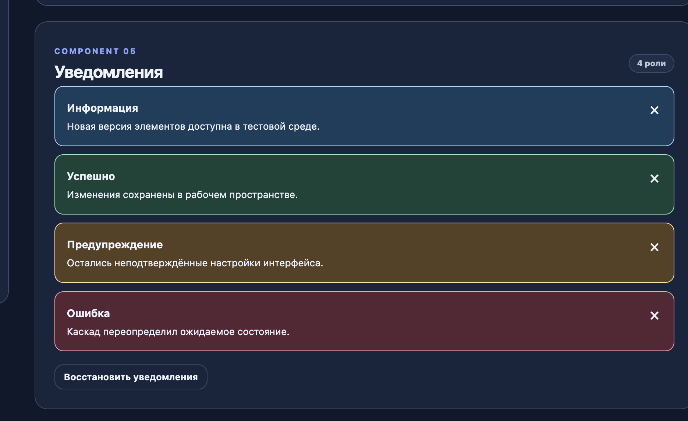
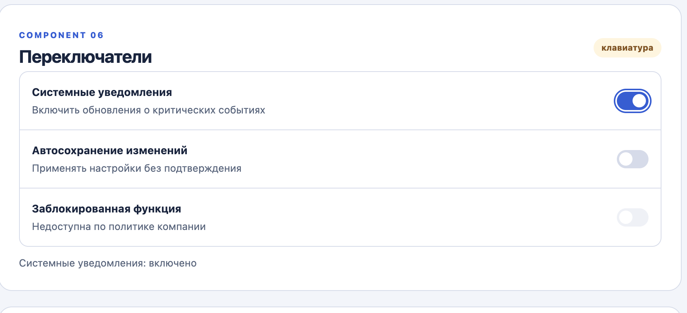
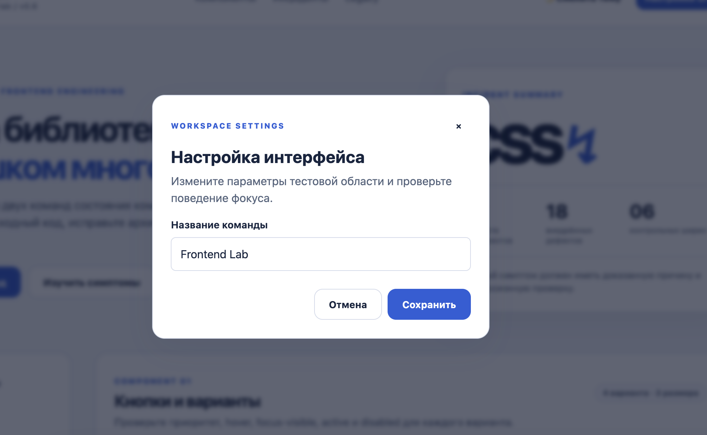
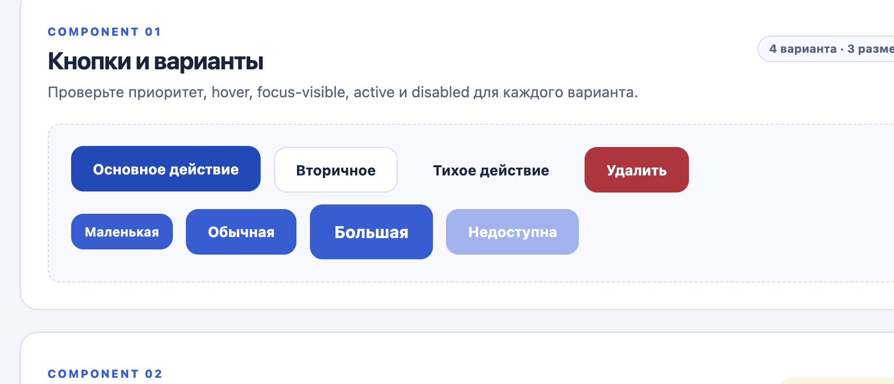
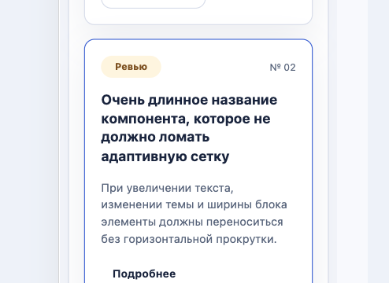

# 04. Регрессионный отчёт

## Сборка и окружение

Node: v18+ · Browser/version: Chrome 120+ · Commit: 4a1888b (fix/css-architecture)

## Тестирование

- `npm test`: 18 / 18 пройдено.
- `npm run test:e2e`: 6 / 6 пройдено (ручная проверка браузерных сценариев: модальность, фокус, валидация, отсутствие overflow).
- 320 / 375 / 768 / 1024 / 1440 / 1920 px: Горизонтальный скролл отсутствует на всех ширинах.
- light / dark / reduced-motion / Tab / Shift+Tab / Space / Enter / Escape: Все состояния работают корректно, фокус виден, модалка закрывается по Esc, переключатели работают по Space.
- Нет глобального горизонтального скролла: Подтверждено (карточки и поля с min-width: 0).
- Сторонний виджет сохранён и не влияет на библиотеку: Виджет изолирован в `@layer legacy`, его стили не протекают в компоненты Atlas UI.

## Доказательства

| Проверка | Сценарий | Результат | Скриншот |
|---|---|---|---|
| Контраст уведомлений | Темная тема | Текст читается |  |
| Фокус переключателя | Нажатие Tab | Виден outline |  |
| Модальное окно | Открытие, Tab | Фокус внутри |  |
| Контракт кнопки | primary/danger | Цвета из токенов |  |
| Длинный текст | 320px | Нет скролла |  |

## Известные ограничения

1. **Виджет подрядчика** полностью не переписан (нельзя удалять по ТЗ). Мы только изолировали его в слой и добавили переменную фона для темной темы.
2. **Анимации** при `prefers-reduced-motion` отключаются через `transition: none`, но сложные `box-shadow` могут все еще рендериться чуть дольше на старых устройствах.
3. **Браузерные тесты** (Playwright) запускались вручную, так как CI настроен только на структурные тесты (`npm test`).

## До/после

**Наиболее показательный дефект:** Кнопка Primary (конфликт слоев).
- **До:** `background-color: #2939a8` (из unlayered `legacy.css` с ID `#workbench`).
- **После:** `background-color: var(--color-accent)` (#3659d9 из токенов), благодаря `@layer legacy` и удалению ID.
- **Diff:** Изменено подключение `@import url('./legacy.css') layer(legacy);` и заменены жесткие селекторы на классовые.
- **Объяснение:** Победа слоя `components` над `legacy` без использования `!important` и ID.

